<div align="center">
  
  <h1>Claude Skills</h1>
  <p>
    Skills and agents for Claude Code that review merge requests, audit dependencies and handle everyday Git work.<br>
    Install only the plugins you need, or let <code>/mwd:setup</code> pick them with you.
  </p>
  <p>
    <a href="https://github.com/mrwake-dev/claude-skills/releases"></a>
  </p>
  <p>
    <a href="#install">Install</a> ·
    <a href="#plugins">Plugins</a> ·
    <a href="#skills">Skills</a> ·
    <a href="#agents">Agents</a> ·
    <a href="docs/">Guides</a> ·
    <a href="#troubleshooting">Troubleshooting</a> ·
    <a href="#development">Development</a>
  </p>
</div>

## Install

You need Claude Code. Each plugin also calls a few command-line tools, listed under [Plugins](#plugins).
No MCP servers are needed.

### Add the plugins

This step is the same on every system. In a Claude Code session, run:

```text
/plugin marketplace add mrwake-dev/claude-skills
/plugin install mwd@mrwake-dev
/reload-plugins
/mwd:setup
```

The first command registers this repo as a plugin source called `mrwake-dev`. The second installs `mwd`,
which holds only `/mwd:setup`. Setup asks which plugins you want, installs them, and checks the tools they
need. Run it again any time to add or remove plugins.

To skip setup, install a plugin directly, for example `/plugin install mwd-review@mrwake-dev`.

Every command and agent starts with its plugin's name: you run `/mwd-review:code-review-interactive`, and
the planner agent is `mwd-agents:planner`.

Claude Code downloads plugins over SSH when you have a GitHub SSH key, and over HTTPS otherwise. Installs
and updates started inside a session don't switch to HTTPS on their own, so on a machine without a key,
set this variable before you add the plugins:

```sh
# macOS and Linux: add it to your shell profile
export CLAUDE_CODE_PLUGIN_PREFER_HTTPS=1
```

```powershell
# Windows: applies to terminals you open afterwards
setx CLAUDE_CODE_PLUGIN_PREFER_HTTPS 1
```

### Install the tools

Install only the tools your plugins need. `/mwd:setup` lists the ones that are missing.

#### macOS and Linux

`git` is usually installed already. Install the rest with Homebrew:

```sh
brew install gh glab jq
```

For `node`, keep the one your version manager (such as nvm) already provides, or download it from
[nodejs.org](https://nodejs.org/en/download).

Log in to GitHub and GitLab once:

```sh
gh auth login     # github.com
glab auth login   # your GitLab instance
```

#### Windows

Install [Git for Windows](https://git-scm.com/downloads/win) first, whatever plugins you use. With it,
Claude Code runs shell commands in Git Bash. Without it, Claude Code falls back to PowerShell, and the
bash scripts these skills run won't work.

Install the rest with winget, in PowerShell:

```powershell
winget install --id Git.Git -e
winget install --id GitHub.cli -e
winget install --id GLab.GLab -e
winget install --id jqlang.jq -e
winget install --id OpenJS.NodeJS.LTS -e
```

Skip the last line if you already manage Node.js with nvm-windows. Then open a new terminal, so it
finds the new commands, and log in once:

```powershell
gh auth login
glab auth login
```

If Claude Code can't find Git Bash, tell it where `bash.exe` is in
`%USERPROFILE%\.claude\settings.json`:

```json
{
  "env": {
    "CLAUDE_CODE_GIT_BASH_PATH": "C:\\Program Files\\Git\\bin\\bash.exe"
  }
}
```

## Plugins

| Plugin           | What it adds                                                         | Tools it needs                  |
|:-----------------|:---------------------------------------------------------------------|:--------------------------------|
| `mwd`            | `/mwd:setup`, which installs the other plugins                       | none                            |
| `mwd-review`     | Interactive code review, report pages and six review agents          | `git`, `jq`, `gh` and/or `glab` |
| `mwd-git`        | Resolving review comments, updating merge requests, rebasing         | `git`, `jq`, `gh` and/or `glab` |
| `mwd-security`   | Dependabot fixes, Node.js and Java security audits                   | `gh`, `jq`, `node`              |
| `mwd-cloudflare` | Preparing a website for Cloudflare Workers                           | `node`                          |
| `mwd-docs`       | Trimming JSDoc comments, checking Markdown                           | `git`                           |
| `mwd-agents`     | Four general agents: explorer, simplifier, planner, dead-code cleaner | none                            |

`gh` covers GitHub and `glab` covers GitLab, so install the one for the platform you use, or both.

## Skills

Run a skill by typing its command in a Claude Code session. Only `/mwd-review:create-artifact` can also
start on its own, when you ask Claude for a page or a dashboard.

| Command | What it does |
|:--------|:-------------|
| `/mwd:setup` | Asks which plugins you want, installs or removes them, and checks the tools they need. |
| `/mwd-review:code-review-interactive <url \| local>` | Reviews a GitLab merge request or a GitHub pull request, asks which findings to post, and posts them as comments on the changed lines. `local` reviews your current branch instead. See the [code review guide](docs/code-review.md). |
| `/mwd-review:create-artifact [what to build] [bg=...]` | Builds a dark page (graphite and violet) from what the session already has, such as a dashboard, a pull request walkthrough or a comparison, and publishes it as a private claude.ai link. `bg=navy`, `oled`, `warm` or a dark hex color changes the background. If publishing is turned off, it tells you which setting blocks it. |
| `/mwd-git:resolve-mr-comments [url]` | Checks every review comment against the current code and applies the fixes you choose. It only edits files; it never commits or pushes. See the [guide](docs/resolve-mr-comments.md). |
| `/mwd-git:update-mr [url]` | Writes or updates the title and description of your branch's merge request from the diff and the conversation: tests you ran, related merge requests, decisions. It keeps what's already there, asks before posting, and can open the merge request as a draft. See the [guide](docs/update-mr.md). |
| `/mwd-git:agent-rebase [target-branch] [--push] [--ci]` | Rebases your branch onto its target (the latest `main` or `master` by default), resolves simple conflicts, regenerates lockfiles and checks the result with the project's own build. It force-pushes only with `--push`; `--ci` also pushes and then watches the pipeline. See the [guide](docs/agent-rebase.md). |
| `/mwd-security:fix-dependabot-alerts` | Reads the repo's open Dependabot alerts and groups the vulnerable packages by severity. For the groups you pick, it upgrades npm, yarn, pnpm, bun, Maven or Gradle dependencies, asks you about risky upgrades, and runs the project's build and tests. It never commits, pushes or writes to GitHub. See the [guide](docs/fix-dependabot-alerts.md). |
| `/mwd-security:node-security-audit` | Checks a Node.js project for vulnerable, outdated and deprecated packages, peer dependency conflicts and Node.js version mismatches, then writes a prioritized upgrade plan. |
| `/mwd-security:java-security-check` | Reviews a Java project for security problems and explains how to fix each one. |
| `/mwd-cloudflare:prepare-to-cf-workers [worker-name]` | Prepares a website for Cloudflare Workers: adds Wrangler and its config, headers and 404 handling, tests the site locally, deploys it once you confirm, and lists the settings for building from Git. |
| `/mwd-docs:shorter-jsdocs [--committed \| --uncommitted] [path...]` | Shortens the JSDoc comments your branch touched and removes the ones that add nothing. |
| `/mwd-docs:markdown-check <file.md> [language]` | Checks a Markdown file's grammar and readability. The language defaults to English. |

## Agents

Claude Code can hand work to these agents. Ask for one by name, for example "use mwd-agents:planner", or
let Claude pick.

| Agent | What it does |
|:------|:-------------|
| `mwd-agents:code-explorer` | Traces how an existing feature works across the codebase before you build on it. It only reads code. |
| `mwd-agents:code-simplifier` | Makes code clearer and more consistent without changing what it does. |
| `mwd-agents:planner` | Turns a feature, an architecture change or a refactor into a step-by-step plan. |
| `mwd-agents:refactor-cleaner` | Finds unused code with knip, depcheck and ts-prune, and removes it. |
| `mwd-review:*` | Six reviewers, one per area: correctness, security, docs, language, device and platform scripts. The code review skill starts them on large changes; you don't call them yourself. |

## Troubleshooting

### A command isn't found

Every command starts with its plugin's name, so it's `/mwd-review:code-review-interactive`, not
`/code-review-interactive`. If the command is still missing, check that its plugin is installed and
enabled:

```sh
claude plugin list
```

If the plugin isn't listed, install it with `/mwd:setup` or `claude plugin install <plugin>@mrwake-dev`.
If it's listed but disabled, run `claude plugin enable <plugin>@mrwake-dev`. Then start a new session, or
run `/reload-plugins` in the current one.

### Every skill and agent shows up twice

The old symlinks from before the plugins are still in `~/.claude`, so Claude Code loads each skill once
from them and once from a plugin. Check with `ls -ld ~/.claude/skills ~/.claude/agents`: an arrow
(`->`) means it's still a link. Replace the links as described in step 1 of
[From the symlink setup](#from-the-symlink-setup).

### Skills fail on Windows

Without Git Bash, Claude Code runs commands in PowerShell, where the skills' bash scripts don't work.
Install Git for Windows (`winget install --id Git.Git -e`) and restart Claude Code. If that doesn't help,
point Claude Code at `bash.exe` with `CLAUDE_CODE_GIT_BASH_PATH`, as shown in [Windows](#windows).

### Skills can't read the merge request or pull request

`gh` or `glab` isn't logged in, or is logged in to a different server. Check both:

```sh
gh auth status
glab auth status
```

Log in with `gh auth login` or `glab auth login`. For a self-hosted GitLab, name the server:
`glab auth login --hostname gitlab.example.com`.

### Installing or updating a plugin fails over SSH

On a machine without a GitHub SSH key, installs started inside a session and plugin updates don't switch
to HTTPS on their own. Set `CLAUDE_CODE_PLUGIN_PREFER_HTTPS=1`, as shown in
[Add the plugins](#add-the-plugins), open a new terminal, and try again.

## Uninstall

To remove one plugin and keep the rest, run `/mwd:setup` and untick it, or:

```sh
claude plugin uninstall mwd-review@mrwake-dev
```

To remove everything, run this instead. It removes the marketplace and uninstalls every plugin from it:

```sh
claude plugin marketplace remove mrwake-dev
```

Both commands work the same on macOS, Linux and Windows. The command-line tools from the install steps
stay installed; remove them with `brew` or `winget` if nothing else uses them.

## Upgrading

### From the single `mwd` plugin

Version 1 put every skill and agent into one plugin, `mwd`. From version 2, `mwd` holds only
`/mwd:setup`, and the skills and agents live in the plugins listed under [Plugins](#plugins). Update the
marketplace, reload, and run setup to pick the plugins you want:

```text
/plugin marketplace update mrwake-dev
/reload-plugins
/mwd:setup
```

Every name changes:

| Version 1                          | Version 2                             |
|:-----------------------------------|:--------------------------------------|
| `/mwd:mwd-code-review-interactive` | `/mwd-review:code-review-interactive` |
| `/mwd:mwd-update-mr`               | `/mwd-git:update-mr`                  |
| `mwd:planner` agent                | `mwd-agents:planner`                  |

Update anything that still uses an old name, such as your `CLAUDE.md`, another skill's `subagent_type`
or a shell alias.

### From the symlink setup

Older versions of this README told you to clone the repo and symlink its `skills/` and `agents/` folders
into `~/.claude`. The plugins replace both, so once you've moved over you can delete the clone.

If you edit the skills, keep the clone: do step 1, add your clone as described in
[Working on the skills](#working-on-the-skills) instead of step 2, and finish with step 4.

1. Replace the symlinks with real folders. First check that each one is a link to your clone (it shows
   an arrow, `->`):

   ```sh
   ls -ld ~/.claude/skills ~/.claude/agents ~/.claude/commands
   rm ~/.claude/skills ~/.claude/agents
   mkdir ~/.claude/skills ~/.claude/agents
   ```

   Without a trailing slash, `rm` removes only the link and leaves your clone alone. If
   `~/.claude/commands` also links to the clone, remove it the same way. The repo has no `commands/`
   folder anymore, so that link points at nothing.

   On Windows, check the links in PowerShell and remove each one with `rmdir`. It deletes a link, but
   refuses to delete a real folder that still has files in it:

   ```powershell
   Get-Item "$env:USERPROFILE\.claude\skills", "$env:USERPROFILE\.claude\agents" | Select-Object FullName, LinkType, Target
   cmd /c rmdir "%USERPROFILE%\.claude\skills"
   cmd /c rmdir "%USERPROFILE%\.claude\agents"
   mkdir "$env:USERPROFILE\.claude\skills", "$env:USERPROFILE\.claude\agents"
   ```

   If `LinkType` is empty, that folder is a copy rather than a link. Rename it instead, and move back
   anything you still need.

2. Add the plugins from GitHub, as described in [Add the plugins](#add-the-plugins), and pick the ones you
   want in `/mwd:setup`.

3. Delete the clone. Nothing loads from it anymore:

   ```sh
   rm -rf ~/Documents/develop/mrwake-dev/claude-skills   # wherever you cloned it
   ```

   In PowerShell, run `Remove-Item -Recurse -Force <path-to-your-clone>`.

4. Switch to the new names. Start a new session, or run `/reload-plugins`, and check that
   `claude plugin list` shows the plugins you picked as enabled. Every name now has its plugin's prefix:

   | Before                         | After                                 |
   |:-------------------------------|:--------------------------------------|
   | `/mwd-code-review-interactive` | `/mwd-review:code-review-interactive` |
   | `planner` agent                | `mwd-agents:planner`                  |

   Update anything that still uses an old name, such as your `CLAUDE.md`, another skill's
   `subagent_type` or a shell alias.

To undo the switch, run `claude plugin marketplace remove mrwake-dev`, which also uninstalls the plugins.
Then clone the repo again, move out anything you put in `~/.claude/skills` and `~/.claude/agents`,
delete both folders, and link the clone's skill and agent folders into `~/.claude`.

## Development

### Working on the skills

Each plugin is a folder under `plugins/`, with its skills in `skills/<name>/SKILL.md` and its agents in
`agents/<name>.md`. To edit them, clone this repo and add your clone instead of GitHub:

```text
/plugin marketplace add <path-to-your-clone>
```

Claude Code then reads every plugin straight from your clone, so `/reload-plugins` picks up an edit
without waiting for a release. Pick "All six plugins" in `/mwd:setup` to have everything installed.

### Updates

All plugins share one version number, set in each `plugins/*/.claude-plugin/plugin.json`. You get a new
version only when a release raises it; commits pushed to `main` between releases don't reach installed
copies. A plugin added from a local clone is the exception: it always uses the files on disk. Each
version's changes are listed on the [Releases](https://github.com/mrwake-dev/claude-skills/releases) page.

Automatic updates are off until you turn them on. Open `/plugin`, go to **Marketplaces**, select
`mrwake-dev` and choose **Enable auto-update**. To update by hand instead, run:

```text
/plugin marketplace update mrwake-dev
```

### Releasing

Run the **Release** workflow on `main` and choose `patch`, `minor` or `major`, either from the repo's
Actions tab or with:

```sh
gh workflow run release.yml -f bump=patch
```

The workflow raises the version in every plugin's `plugin.json`, commits them as `release: X.Y.Z`, tags
the commit `X.Y.Z` and pushes both. It stops first if the plugins don't all have the same version. It then
starts the **Changelog** workflow, which publishes a GitHub release. The release notes list the commits
since the previous tag, grouped by type: `feat`, `fix`, `docs` and so on.

You can also push an `X.Y.Z` tag yourself. Changelog publishes a release for it only if
`plugins/mwd/.claude-plugin/plugin.json` at that tag already has the same version, because installed
copies would never get it otherwise.
